# Usuarios, grupos y permisos

En Forja Iron Club cada persona entra a Odoo con su propio usuario y solo ve lo que necesita para su trabajo. Es el principio de mínimo privilegio: si un comercial no tiene que tocar la contabilidad, no tiene acceso a ella, y así un error o un mal uso no puede llegar tan lejos.

Antes de crear nada activé el **modo desarrollador** (`localhost:8069/odoo?debug=1`). Con él aparecen opciones técnicas, como los grupos y sus permisos de modelo, que se usan más abajo.

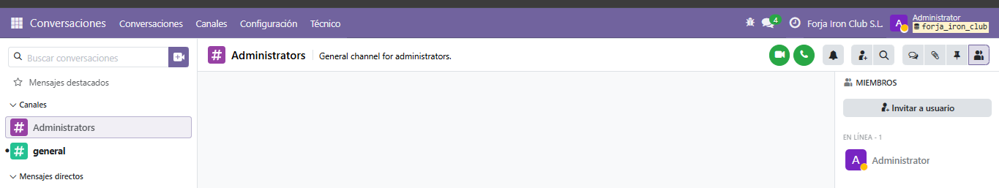

## Tipos de usuario en Odoo

Odoo distingue tres tipos, y no todos son empleados:

- **Interno:** persona de la empresa con acceso al backoffice, es decir, al programa completo. Sus permisos se reparten por aplicaciones.
- **Portal:** cliente o proveedor externo. No ve el backoffice. Solo entra a una página "Mi cuenta" donde consulta sus propios pedidos, facturas y direcciones.
- **Público:** visitante sin sesión iniciada, por ejemplo quien mira la web. Solo ve lo que la empresa ha publicado.

## Usuarios creados

Las contraseñas no se guardan en este repositorio. Aquí solo figura el correo de inicio de sesión.

| Usuario | Rol | Inicio de sesión | Permisos principales |
|---|---|---|---|
| Carlos Sánchez Mora | Comercial | carlos.sanchez@forjaironclub.es | Ventas: solo documentos propios. Descuentos en líneas. Sin Contabilidad ni Inventario. |
| Jorge Moreno Rivero | Responsable de ventas | jorge.moreno@forjaironclub.es | Ventas: Administrador. Inventario: Usuario. Descuentos en líneas. Sin Contabilidad. |
| Laura Prieto Vega | Administración | laura.prieto@forjaironclub.es | Contabilidad: Facturación. Ventas: ver todos los documentos, sin administrar. Sin Inventario. |
| Logística Alcazaba Sur S.L. | Cliente (portal) | administracion@logisticaalcazaba.example | Solo ve sus pedidos y sus facturas. |

El usuario Administrator se queda para configurar Odoo y no interviene en la venta.

### Por qué esos permisos

A **Carlos** le basta con preparar presupuestos para sus clientes. Con "solo documentos propios" no ve los de otros compañeros. Tiene activado "Descuentos en líneas" porque en el presupuesto hay una línea con descuento y la hace él.

**Jorge** gestiona toda la venta. Necesita Inventario para validar la entrega y comprobar que baja el stock.

**Laura** crea y registra las facturas y los pagos. Ve los pedidos para poder facturarlos, pero no es Administrador de Ventas, así que no configura nada de esa aplicación.

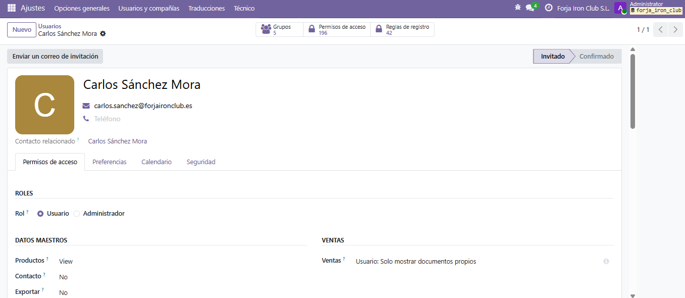
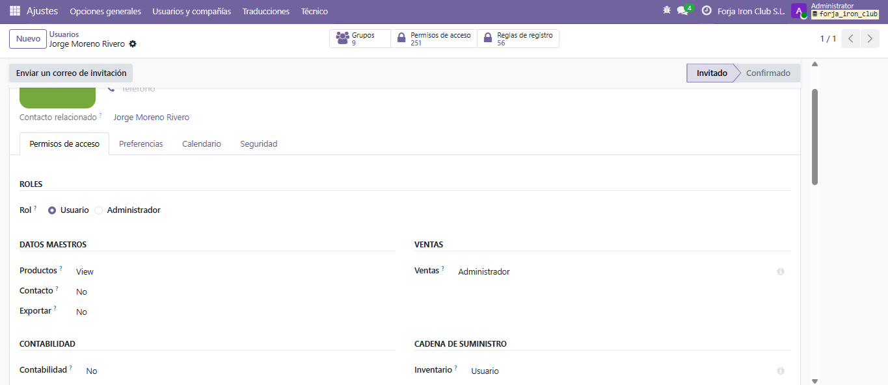
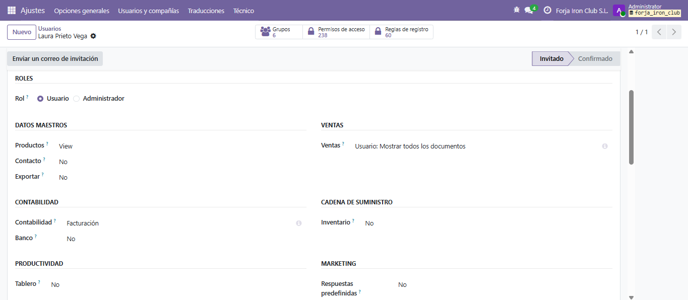

## Usuario portal

Para el cliente Logística Alcazaba Sur S.L. concedí acceso al portal desde su ficha de contacto (Acciones → Conceder acceso al portal). Odoo crea con eso un usuario externo, que se reconoce por la cinta "Usuario externo" del formulario.

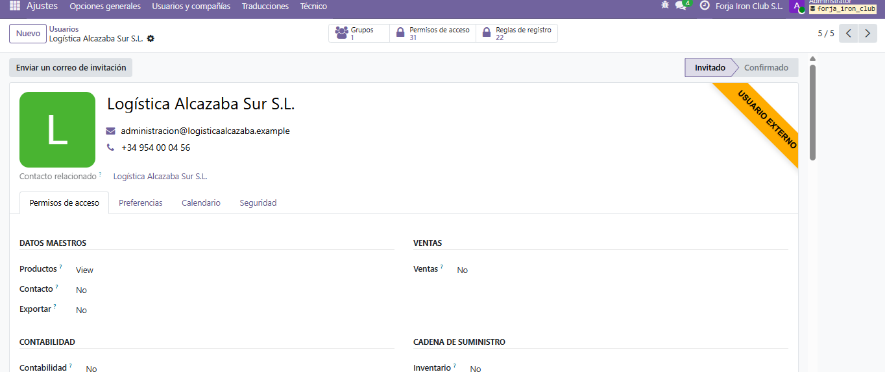

## Grupo propio: Forja Iron Club / Comercial junior

Además de los permisos de cada aplicación, creé un grupo propio con la empresa como privilegio. Sirve para dar permisos concretos a un puesto sin tocar el resto.

- **Hereda** el grupo de Ventas "Usuario: solo mostrar documentos propios", de modo que quien esté en el grupo parte de esos permisos.
- **Permisos de modelo** (Permisos de acceso del grupo):
    - Contacto: leer, escribir y crear, pero no eliminar. Puede dar de alta clientes sin poder borrarlos.
    - Producto: solo lectura. Ve el catálogo y no lo modifica.
- **Asignado a:** Carlos Sánchez Mora.

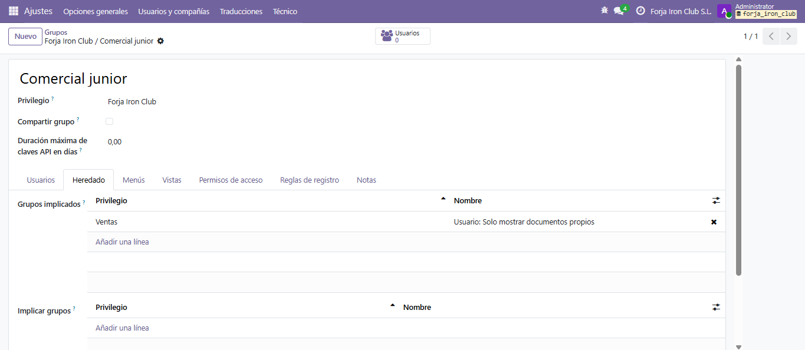
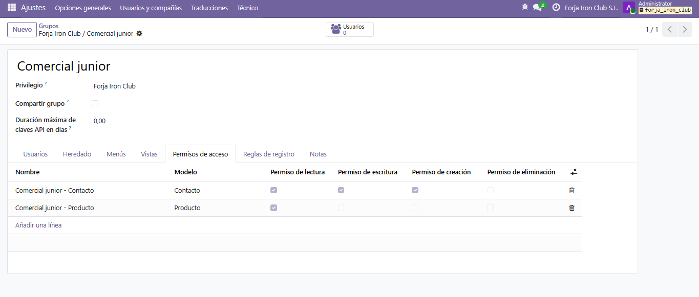
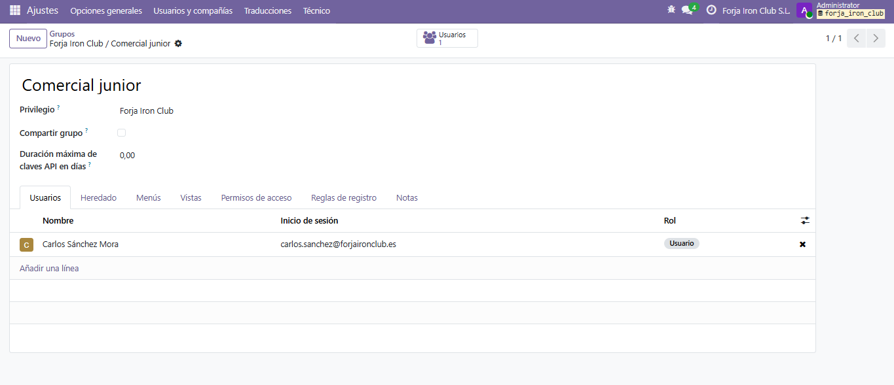

## Pruebas iniciando sesión con cada usuario

Para comprobar que los permisos funcionan entré en una ventana de incógnito con cada usuario, sin cerrar la sesión del administrador. En las capturas se ve quién ha iniciado sesión, con su avatar o su nombre arriba a la derecha.

**Carlos** ve Conversaciones, Contactos, Ventas, Tableros y Aplicaciones. No tiene Facturación, Inventario ni Ajustes. Probé a abrir la lista de usuarios y no hay botón de crear.

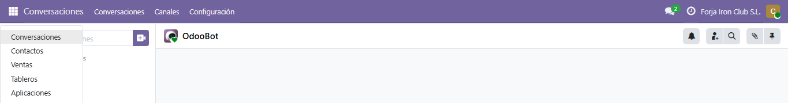
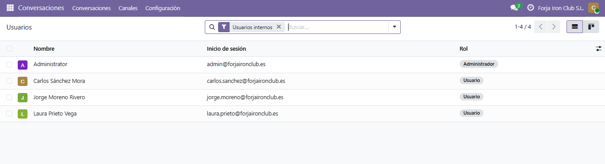

**Jorge** ve Ventas e Inventario, que es lo que necesita para vender y entregar.

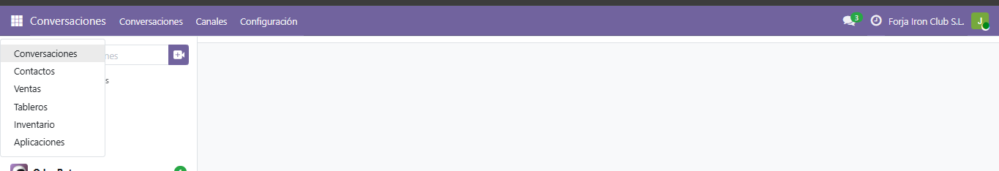

**Laura** ve Facturación y Ventas, y no tiene Inventario.

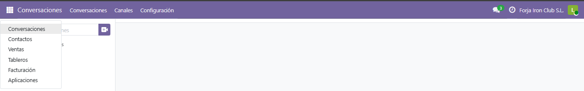

**El cliente (portal)** no tiene menú de aplicaciones. Solo ve "Mi cuenta" con sus pedidos, facturas y direcciones.

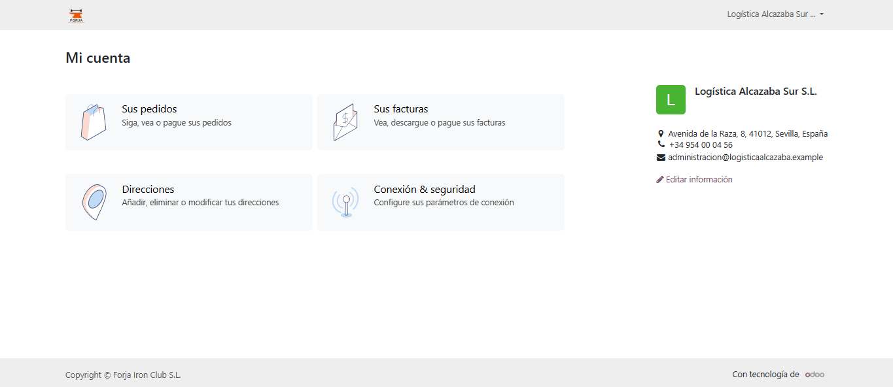

La prueba de que Carlos solo ve sus propios presupuestos está en [proceso de venta](../venta/proceso-venta.md), porque ahí se aprecia con documentos reales.