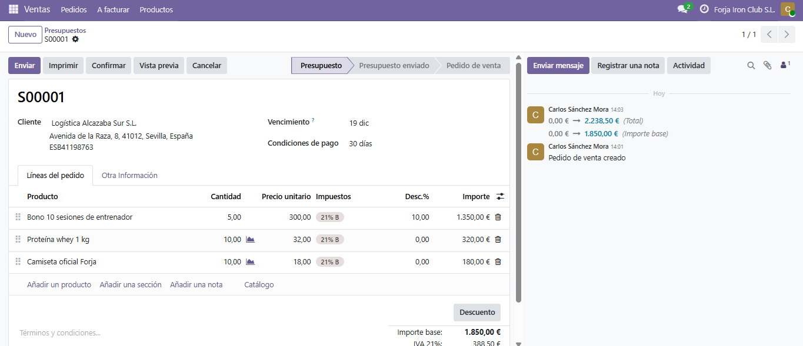
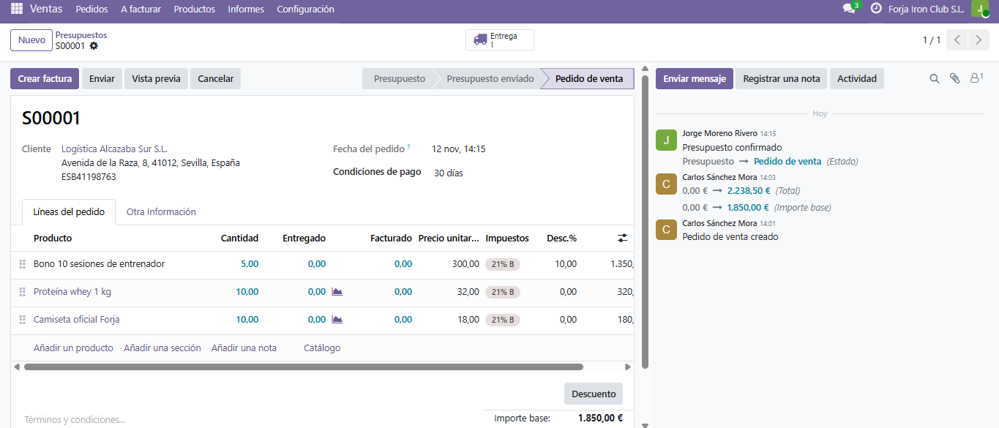
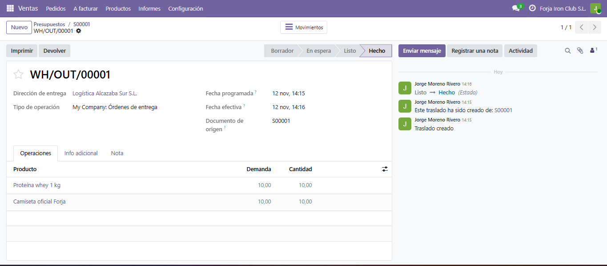
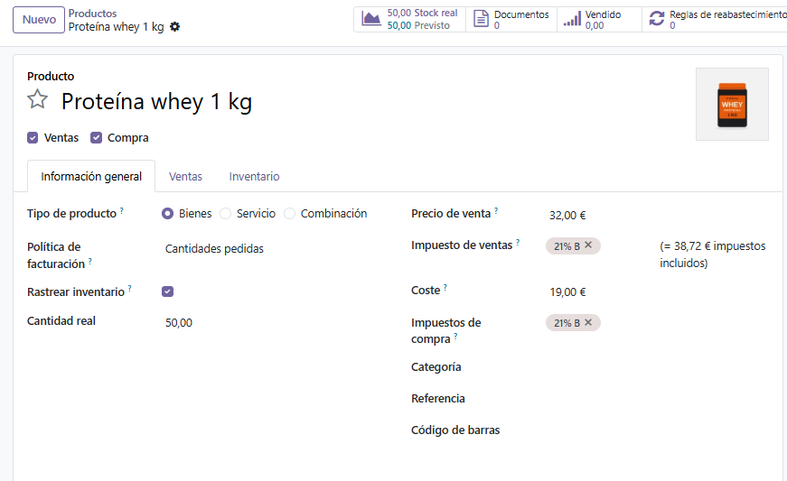
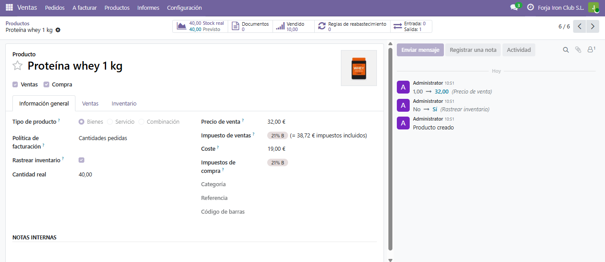
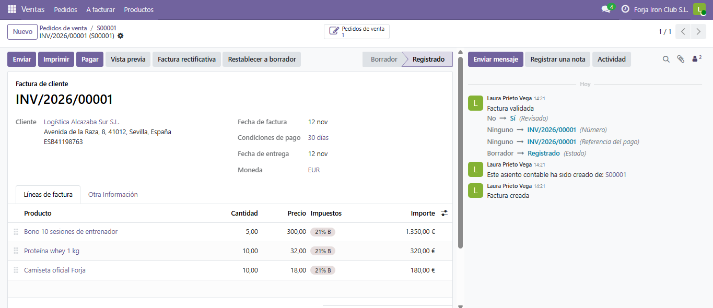
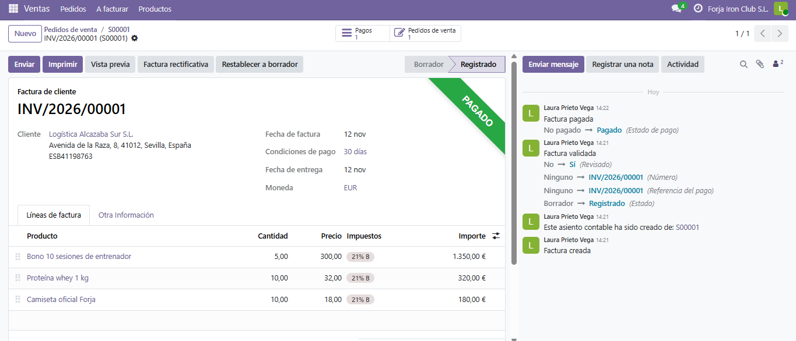
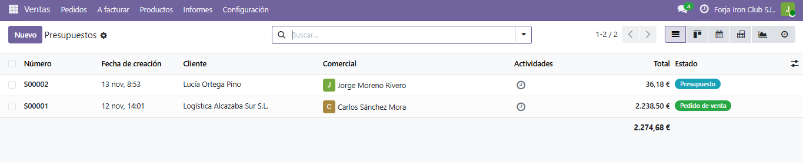
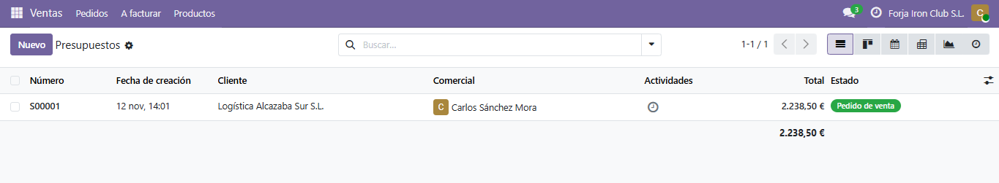

# Proceso de venta

Venta de una cuota, bonos, proteína y camisetas a **Logística Alcazaba Sur S.L.**, la empresa con convenio. Cada paso lo hizo el usuario al que le corresponde, para que el flujo respete los permisos que se explican en [usuarios y permisos](../usuarios/usuarios-grupos-permisos.md).

| Paso | Documento | Quién lo hace | Por qué ese usuario |
|---|---|---|---|
| 1. Presupuesto | S00001 | Carlos Sánchez Mora (Comercial) | Prepara las ofertas y tiene permiso para aplicar descuentos. |
| 2. Confirmar el pedido | S00001 | Jorge Moreno Rivero (Responsable de ventas) | Aprueba el presupuesto antes de que se convierta en pedido. |
| 3. Validar la entrega | WH/OUT/00001 | Jorge Moreno Rivero | Es el que tiene acceso a Inventario. |
| 4. Facturar y contabilizar | INV/2026/00001 | Laura Prieto Vega (Administración) | Gestiona facturas y pagos. |
| 5. Registrar el pago | Pago de 2.238,50 € | Laura Prieto Vega | Es su función. |

## 1. Presupuesto

Carlos creó el presupuesto S00001 con fecha del 12/11/2026 y vencimiento el 19/12/2026. Las condiciones de pago son a 30 días.

| Producto | Cantidad | Precio | Descuento | Importe |
|---|---|---|---|---|
| Bono 10 sesiones de entrenador | 5 | 300,00 € | 10 % | 1.350,00 € |
| Proteína whey 1 kg | 10 | 32,00 € | | 320,00 € |
| Camiseta oficial Forja | 10 | 18,00 € | | 180,00 € |

Base imponible: 1.850,00 €. IVA (21 %): 388,50 €. **Total: 2.238,50 €.**

El PDF del presupuesto, generado desde Odoo, está en [presupuesto.pdf](presupuesto.pdf).

## 2. Confirmación del pedido

Jorge abrió el presupuesto de Carlos y lo confirmó. El presupuesto pasó a pedido de venta y Odoo creó la orden de entrega. En el historial de la derecha se ve que fue Jorge quien lo hizo.

## 3. Entrega y stock

Jorge validó la entrega WH/OUT/00001, que pasó a **Hecho**. Al validar, Odoo mostró un aviso para enviar un SMS al cliente. Pulsé "Deshabilitar SMS" porque no hay ningún servicio de mensajes configurado.

La proteína es el producto con control de stock. Antes de la venta había 50 unidades y, tras entregar 10, quedan 40. Las camisetas y el bono no llevan control de inventario, así que su stock no cambia.

| Antes de la venta | Después de la entrega |
|---|---|
|  |  |

## 4. Factura

Laura creó la factura desde el pedido con la opción "Factura normal" y la confirmó. Quedó registrada como **INV/2026/00001**.

## 5. Pago

Laura registró el pago completo de 2.238,50 € desde el diario Banco. La factura pasó a **Pagado**.

El PDF de la factura, impreso desde Odoo, está en [factura.pdf](factura.pdf). Aparece con el importe adeudado a 0,00 €.

## Prueba de "solo documentos propios"

Para comprobar que Carlos solo ve lo suyo, Jorge creó un segundo presupuesto (S00002) para otra clienta, Lucía Ortega Pino. Jorge ve los dos documentos y Carlos solo el suyo, el S00001.

